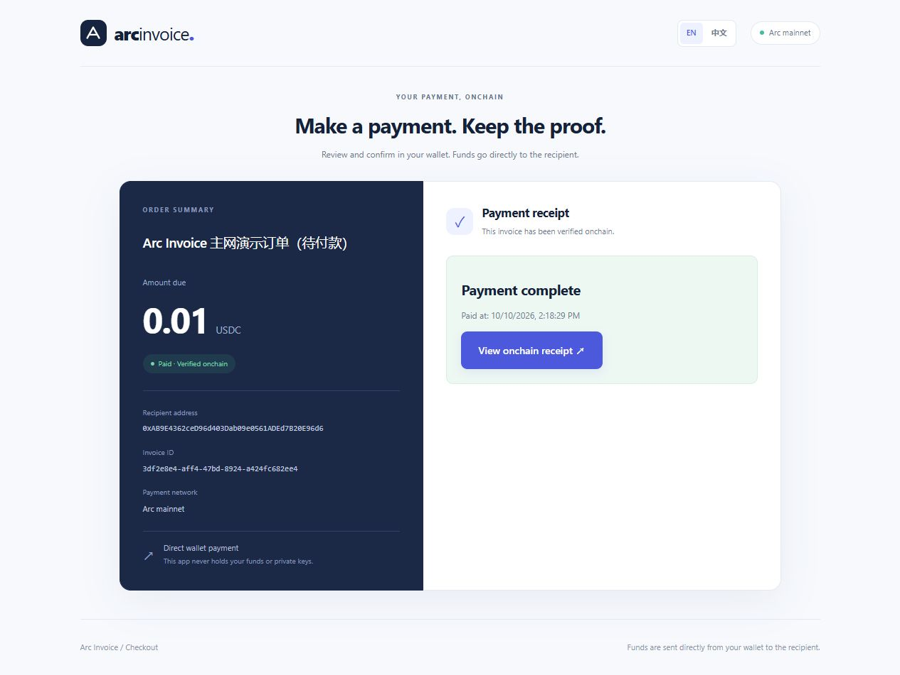
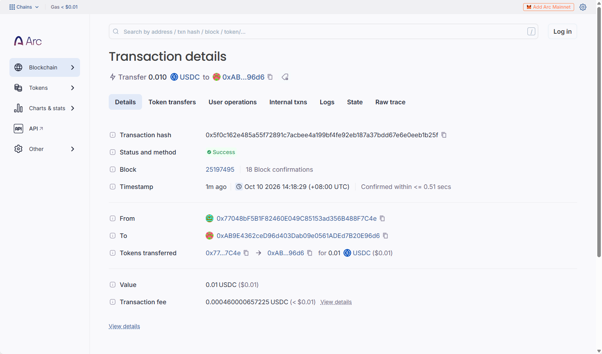

# Arc Invoice

USDC payment links and invoice reconciliation on **Arc mainnet**. A merchant creates an invoice, a customer pays from their own wallet, and the server matches the successful onchain transfer to the invoice.

**Live demo:** https://170.106.189.16.sslip.io:8443

**Source:** https://github.com/hillmanpick/arc-invoice

Arc Invoice is a small merchant checkout and reconciliation tool on Arc. Customers pay native USDC directly from their wallets; the server verifies successful onchain transfers and invoice references, and prevents duplicate reconciliation.

**Status (2026-10-10):** deployed prototype with one successful, user-signed 0.01 USDC payment on Arc mainnet. This demonstrates the checkout-to-receipt flow; it is not evidence of independent customer adoption or production scale.

## Review the working project

- [Live app](https://170.106.189.16.sslip.io:8443)
- [Verified invoice / public receipt](https://170.106.189.16.sslip.io:8443/pay/3df2e8e4-aff4-47bd-8924-a424fc682ee4) — opens without a merchant login or another payment.
- [Successful Arc transaction](https://explorer.arc.io/tx/0x5f0c162e485a55f72891c7acbee4a199bf4fe92eb187a37bdd67e6e0eeb1b25f)
- [Builder profile](https://github.com/hillmanpick)
- [Submission text and eligibility declarations](SUBMISSION.md)
- [Recorded mainnet evidence and reproduction steps](docs/MAINNET_PROOF.md)





## Why Arc

The intended use case is a small merchant who can receive a wallet transfer but needs to know which invoice it settles. Arc Invoice uses Arc mainnet (chain ID **5042**) for native USDC payments and USDC gas fees. Each transaction carries `ArcInvoice:v1:<invoice UUID>` in its data field. This binds the payment to an invoice rather than inferring it from a wallet balance change.

The server checks the chain, receipt success, transaction/block consistency, exact recipient and amount, invoice reference, and invoice creation time before marking it paid. Native USDC amounts use **18 decimals**, with string/BigInt arithmetic; the separate six-decimal ERC-20 interface is not used. A unique transaction hash prevents one payment from settling two invoices.

This prototype uses ordinary Arc transactions rather than a custom payment contract. It has no app-held signing keys and no custom contract to deploy or audit, but does not support internal smart-wallet transfers or arbitrary transfers without the invoice reference. The implementation uses EVM-compatible tooling and is configured and verified on Arc; it does not claim a new consensus mechanism or exclusive protocol innovation.

## Quality, scope and next steps

- English by default, with persistent Chinese/English switching and responsive layouts.
- Automatic receipt verification when a transaction hash is available, plus automatic order-state refresh across open checkout pages.
- Nine payment/database tests cover precision, invalid transfers, required payers, legacy database migration, address history and duplicate settlement; production builds and browser checks are recorded in [VALIDATION.md](VALIDATION.md).
- Choose a recipient for each invoice and optionally require a specific payer. Authenticated address history supports reuse of previous recipients and verified payers.
- SQLite WAL storage in a persistent server Docker volume, checked daily backups, and a downloaded backup snapshot. Continuous offsite backup sync is not configured.
- Current scope: one operator login, one app instance, configurable recipient wallets per invoice, public invoice links, and native-USDC transfers through the checkout flow. Merchant invoice creation requires an admin login; reviewer receipt inspection does not.

Next priorities are continuously automated offsite backups, broader wallet compatibility checks, clearer RPC failure recovery, and database/rate-limit changes before multi-instance use. Refunds, a background chain indexer, contract-wallet internal transfers, and high-volume operation are not implemented. One real payment and the current test suite do not constitute a security audit.

Arc 主网 USDC 收款与对账原型已上线，并已完成一笔真实主网付款验证。

## 环境

- Ubuntu + Docker + Docker Compose v2；或 Node.js 22.13 以上。
- GitHub 公开仓库。
- 一个普通钱包收款地址；本版拒绝带合约代码的收款地址，包含使用 EIP-7702 委托代码的账户。
- 公网 HTTPS 网站地址。没有自己的域名，可以使用免费子域名；域名不是活动的单独要求，HTTPS 是钱包与网站正常交互所需的部署条件。
- 付款钱包中的 Arc 主网 USDC，以及额外的 USDC 网络手续费。

不需要把助记词或私钥交给应用。服务器没有私钥配置，付款由用户钱包直接签名。

## 技术与选择

Next.js/TypeScript 同时提供网页和 API，viem 处理钱包与 RPC，Node.js 内置 SQLite 持久化订单，Docker 固定运行环境。初版直接使用 viem 的 EIP-1193/EIP-6963 钱包接口，不引入 wagmi 和额外状态库，减少依赖；需要完整的钱包连接生态时可扩展。

SQLite 适合一个商户、一个应用副本的演示；使用 WAL、参数化 SQL、交易哈希唯一约束。相比 PostgreSQL 少一个数据库服务，但不适用于多副本部署和大规模并发。保持一个应用实例，不能把同一个 SQLite 卷挂到多个应用副本。

付款使用 Arc 原生 USDC 转账和交易 data 中的订单标识，不新增支付合约。相比托管钱包或自定义支付合约，少了私钥保管与合约维护工作；代价是普通钱包收款、需要经本应用付款流程，手动发送不带订单标识的转账无法自动抵扣。本版支持不同订单使用不同收款钱包；不支持单笔订单拆分给多个收款方、合约钱包内部转账、退款、付款撤销或离线自动索引。

## 收付款地址与历史记录

创建订单时填写收款地址；`MERCHANT_ADDRESS` 只是可编辑的默认值。指定付款地址为选填，留空允许任意钱包付款。填写后，钱包连接和发送前会检查账户，服务器也会核对真实交易的 `from`，不接受其他钱包代付。实际付款仍需地址持有人在钱包中签名；仅输入地址不会授权扣款。已创建订单的地址及金额不能修改，请为新收款方创建新订单。

工作台提供历史收款、付款地址及一键复用。收款历史统计创建的订单，付款历史只统计已核验到账的真实付款人，不把指定但未付款的地址当作成功付款人。每类显示最近使用的 100 个不同地址、累计订单数和最后使用时间；统计覆盖整个数据库，订单列表显示最近 200 笔。历史接口需要管理登录且禁止缓存。

升级会自动给原 SQLite 表增加可空的 `expectedPayer` 字段；旧订单保持原收款地址、金额、状态及交易凭证，不新增付款地址限制。地址历史从持久化订单聚合，无新增数据库服务或浏览器本地通讯录。

## 核对过的网络配置

2026-10-10 查阅官方文档：

| 参数 | 值 |
| --- | --- |
| Chain ID | 5042 |
| 主网 RPC | https://rpc.mainnet.arc.io |
| 浏览器 | https://explorer.arc.io |
| 原生 USDC 精度 | 18 |
| ERC-20 USDC 精度 | 6；与原生接口共享余额，本应用不使用此接口 |

来源：https://docs.arc.io/arc/references/connect-to-arc 和 https://docs.arc.io/build/evm-differences 。Arc 的 `maxFeePerGas` 有 20 Gwei 下限，付款端会在网络估算基础上应用该下限，Gas 总费用仍由估算与钱包确认决定。生产部署前应再次核对官方参数。

金额使用字符串和 BigInt 精确转换；没有 JavaScript 浮点记账。界面限制六位小数是订单产品限制，实际原生转账按十八位精度处理。

## 本地启动

```bash
npm ci
cp .env.example .env.local
```

编辑 `.env.local`：

```dotenv
MERCHANT_ADDRESS=你的公开收款地址
ADMIN_TOKEN=随机管理口令至少32字符
SESSION_SECRET=另一个随机值至少32字符
COOKIE_SECURE=false
ARC_RPC_URL=https://rpc.mainnet.arc.io
DATA_DIR=./data
```

生成两个独立随机值可以分别执行 `openssl rand -hex 32`。使用 `.env.local` 仅供本地 Next.js；Docker 使用 `.env`。不要把环境文件提交到 GitHub。

```bash
npm run dev
```

打开 http://localhost:3000 。进入商户工作台，使用 `ADMIN_TOKEN` 登录。localhost 可以用于钱包开发，公网 IP 的普通 HTTP 页面不适合正式钱包演示。

## Ubuntu Docker 启动

如果还没有 Git，执行 `sudo apt-get update`、`sudo apt-get install -y git`。将本目录推送到你自己的 GitHub 公开仓库后：

```bash
git clone <你的仓库HTTPS地址> arc-invoice
cd arc-invoice
cp .env.example .env
nano .env
docker compose version
docker compose up -d --build
docker compose ps
docker compose logs --tail=80 app
curl -I http://127.0.0.1:3000
```

`.env` 填写公开收款地址与两个独立随机值。公网部署保持 `COOKIE_SECURE=true`。

默认只将端口发布到服务器 `127.0.0.1:3000`，通过 HTTPS 反向代理访问，不直接暴露应用端口。现有 Nginx/Caddy 也可以代理到这里；如果该端口被占用，将 compose 中左侧端口改成空闲端口，同时修改反向代理上游。检查现有服务后再安装代理，避免占用已有的 80/443。

### HTTPS 入口

优先使用你控制的域名或免费子域名，DNS 指向服务器 IP。如果暂无域名，可以临时尝试 `你的IPv4.sslip.io`；该服务属于第三方，解析或证书申请可能受限制，失败时改用自己控制的域名。没有域名并不需要推迟本地开发。

若服务器尚无反向代理，可使用 Caddy。Caddy 官方安装说明：https://caddyserver.com/docs/install 。安装前检查端口与防火墙：

```bash
sudo ss -lntp
sudo ufw status
```

把下面站点块加入现有 `/etc/caddy/Caddyfile`，替换实际主机名；不要直接覆盖其他站点配置：

```caddyfile
你的域名 {
    reverse_proxy 127.0.0.1:3000
}
```

```bash
sudo caddy validate --config /etc/caddy/Caddyfile
sudo systemctl reload caddy
```

云安全组与服务器防火墙需要允许 TCP 80/443；保留 SSH 端口。Caddy 自动申请证书需要 DNS 正确解析且外部可达。HTTPS 访问成功后再登录和连接钱包。

## 验收

1. HTTPS 打开首页，在商户工作台登录。
2. 创建 0.01 USDC 订单；复制链接并用另一个付款钱包打开。
3. 在钱包确认 Arc 主网、收款地址、0.01 USDC 金额与手续费。
4. 签名付款。页面保存交易哈希并自动核验到账；暂时故障后降频继续重试。页面可见时每 4 秒读取订单状态，确认后自动显示凭证。保留哈希，避免重复付款。
5. 确认页面显示已付款，主网浏览器显示交易成功。
6. 回工作台刷新，确认到账记录存在。重启容器后记录仍应保留。
7. 失败交易、金额不符、其他订单的交易均不能标记为到账。

服务器核验 chain ID、回执成功、区块一致性、收款地址、原生金额、订单 data、时间；数据库拒绝同一哈希重复记账。不会只信浏览器提交的“成功”标记。订单链接包含随机 UUID，知道链接的人能看到订单金额、说明及公开付款记录，所以不要填写私人订单信息。

## 验证与边界

```bash
npm test
npm run typecheck
npm run build
```

测试覆盖精度、错误网络/地址/金额、回执失败、订单绑定、旧交易和重复入账。管理口令和会话使用 HttpOnly Cookie；登录尝试有限额、核验 RPC 并发有限额。当前限额是单进程演示级保护，公开长期服务应加持久化限流、告警和数据库备份。

SQLite 数据保存在服务器的 Docker 命名卷 `invoice-data`，本机开发数据库和线上数据库互相独立。本机删除数据库不会影响服务器。普通重启和 `docker compose down` 保留数据，`docker compose down -v` 会删除数据卷，避免误执行。

运行 `bash scripts/backup-server.sh` 会使用 Node SQLite 在线 backup API 创建一致快照，检查完整性，并将备份复制到服务器 `/home/ubuntu/arc-invoice-backups`。它包含已提交的 WAL 数据，无需停止应用。该 API 要求 Node 22.16 以上；Docker Node 22 当前镜像支持。

`scripts/arc-invoice-backup.service` 和 `.timer` 提供每天一次的备份（按服务器时区运行），需要按部署目录和 Linux 用户调整后安装到 `/etc/systemd/system`。备份目录与数据库卷仍处于同一台服务器，不能替代异地备份；应定期将备份复制到独立电脑或对象存储。不要在数据库写入期间只复制主文件而漏掉 WAL。

迁移到 PostgreSQL/托管数据库适合多实例、高并发和独立运维，但不能免除备份。链上交易不会因数据库丢失而消失；订单说明、订单与交易的对应关系等应用数据仍需要数据库备份恢复。

代码构建和模拟测试不代替 Arc 主网验证。2026-10-10 钱包持有人亲自签名完成一笔 0.01 USDC 主网付款，证据见 [MAINNET_PROOF.md](docs/MAINNET_PROOF.md)。自动化助手没有替持有人签名或发送资金。

## Interface languages / 界面语言

The interface defaults to English. Use **EN / 中文** in the header to switch instantly. The selected language is saved for one year in the `arc_invoice_locale` cookie and read during server rendering, so navigation and reloads keep the same language. Browser language settings do not override the English default.

首页、商户工作台、付款页、未找到订单页和应用错误提示支持中英文。日期跟随所选语言格式显示。翻译表位于 `lib/translations.ts`，React Context 共享语言状态，无外部翻译 API 或新增依赖。订单说明等用户输入内容保持原文；第三方钱包自身提示由钱包控制。

## Automatic payment updates

Pending checkout pages read the latest invoice every four seconds while visible, and immediately when returning to the tab. A confirmed invoice switches to its receipt automatically and stops polling. These reads bypass caches and do not require a locally saved transaction hash. If a hash is available, onchain verification continues after temporary RPC failures, slowing to once every 30 seconds after the first 12 attempts. Invalid transactions are not retried.
